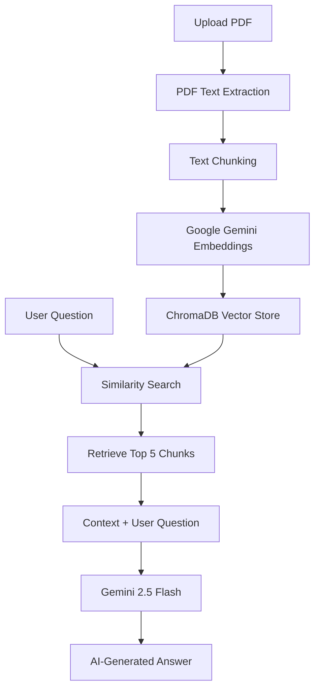

# 📚 PDF Intelligence

**PDF Intelligence** is an AI-powered document question-answering application built using **Streamlit, LangChain, Google Gemini, and ChromaDB**.

Upload a PDF, let the application extract and index its content, and ask questions in natural language. The application retrieves relevant information from the document and uses Google Gemini to generate context-aware answers.

## ✨ Features

- 📄 **PDF Upload:** Upload PDF documents directly through the Streamlit interface.
- 📝 **Text Extraction:** Extract document content using LangChain's `PyPDFLoader`.
- ✂️ **Text Chunking:** Split extracted text into smaller overlapping chunks for efficient retrieval.
- 🔍 **Semantic Search:** Generate embeddings using Google's `gemini-embedding-001` model and store them in ChromaDB.
- 🤖 **AI-Powered Answers:** Retrieve the five most relevant chunks and generate answers using Gemini 2.5 Flash.
- 🎯 **Context-Based Responses:** Generate answers based on the uploaded document. If the information is unavailable, the application indicates that the PDF does not provide it.
- 💬 **Chat History:** Maintain conversation history during the current Streamlit session.
- 🔄 **Document Change Detection:** Identify whether the currently selected PDF matches the previously processed document.
- 🗑️ **Clear Chat:** Clear conversation history using the sidebar.
- 🧹 **Temporary File Cleanup:** Automatically remove temporary PDF files after processing.

## 🧰 Tech Stack

| Technology | Purpose |
|---|---|
| Python | Core programming language |
| Streamlit | Web interface and session management |
| LangChain | Retrieval-Augmented Generation (RAG) pipeline |
| Google Gemini 2.5 Flash | AI response generation |
| Google Gemini Embeddings | Text embedding generation |
| ChromaDB | Vector database and similarity search |
| PyPDF | PDF text extraction |
| python-dotenv | Environment variable management |

## ⚙️ How It Works

The application follows a **Retrieval-Augmented Generation (RAG)** architecture.

### Workflow

1. **Upload PDF:** The user uploads a PDF document.
2. **Extract Text:** `PyPDFLoader` extracts text from the document.
3. **Text Splitting:** `RecursiveCharacterTextSplitter` divides the extracted text into chunks of 400 characters with an overlap of 100 characters.
4. **Generate Embeddings:** Google Gemini's embedding model converts text chunks into vector representations.
5. **Store Vectors:** The generated embeddings are stored in ChromaDB.
6. **User Query:** The user asks a question about the uploaded document.
7. **Retrieve Context:** ChromaDB performs similarity search and retrieves the five most relevant chunks.
8. **Generate Answer:** Gemini 2.5 Flash generates an answer using the retrieved context and user question.

### RAG Architecture



## 🚀 Getting Started

Follow these steps to run the project locally.

### 1. Clone the Repository

```bash
git clone <your-repository-url>
cd <your-repository-folder>
```

Replace the placeholders with your actual GitHub repository URL and folder name.

### 2. Create a Virtual Environment

**Windows:**

```bash
python -m venv venv
venv\Scripts\activate
```

**macOS / Linux:**

```bash
python3 -m venv venv
source venv/bin/activate
```

### 3. Install Dependencies

Install the required Python packages:

```bash
pip install streamlit python-dotenv langchain-google-genai langchain-chroma langchain-core langchain-text-splitters langchain-community pypdf
```

### 4. Configure Google Gemini API Key

1. Visit [Google AI Studio](https://aistudio.google.com/).
2. Generate your Google Gemini API key.
3. Create a `.env` file in the project's root directory.
4. Add the following configuration:

```env
GOOGLE_API_KEY=your_google_api_key_here
```

Replace `your_google_api_key_here` with your actual API key.

**Important:** Never share your API key or commit your `.env` file to GitHub.

### 5. Run the Application

If your main Python file is named `app.py`, execute:

```bash
streamlit run app.py
```

The application will start locally at:

```text
http://localhost:8501
```

## 💡 How to Use

1. Start the Streamlit application.
2. Upload a PDF using the **Choose a PDF file** option.
3. Click **Upload & Process PDF**.
4. Wait for the application to extract text, generate embeddings, and create the vector store.
5. Once processing is complete, navigate to the **Chat with your PDF** section.
6. Enter your
